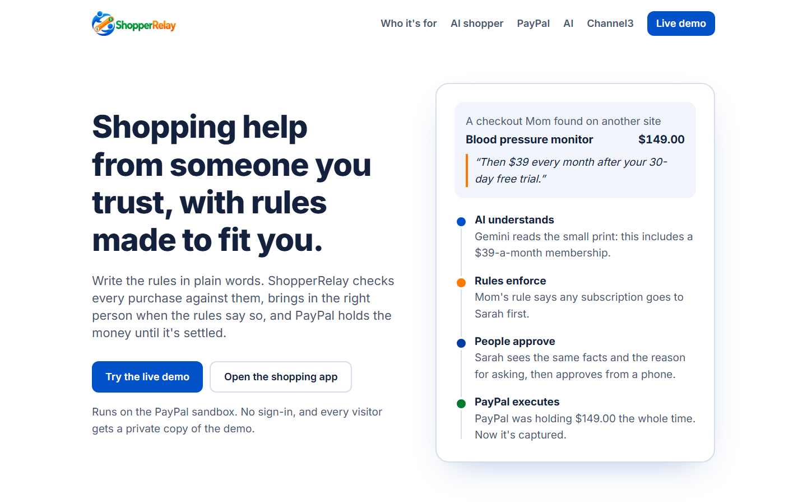
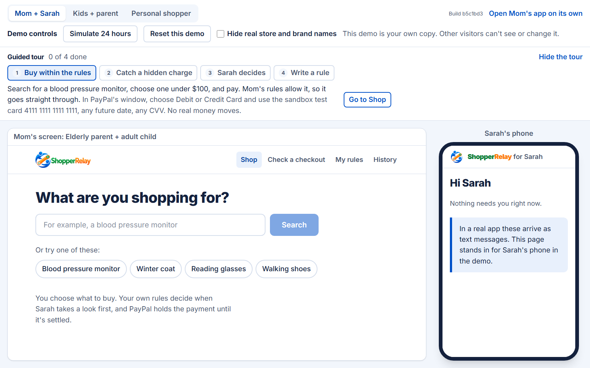

# ShopperRelay

**Shopping help from someone you trust, with rules made to fit you.**

One person finds what to buy. Written rules decide what can be bought straight away and what someone
else sees first. PayPal holds the money until it's settled. It works the same whether the shopper is
an older parent, a child, a personal shopper or an AI agent.

**AI understands. Rules enforce. People approve. PayPal executes.**

Built for the PayPal AI Hackathon.

[](https://www.shopperrelay.com)

- **Live site:** https://www.shopperrelay.com
- **Live demo:** https://www.shopperrelay.com/demo (the shopper's screen and the reviewer's phone side
  by side, with a guided tour for each relationship)
- **Backup address** (same app): https://shopper-relay.vercel.app
- Everything runs on the PayPal **sandbox**. No real money moves. No sign-in needed.

## Try it in three minutes

Open **[/demo](https://www.shopperrelay.com/demo)** and follow the guided tour above the two screens.
Its steps tick off as they really happen. Use the tabs to switch between the three relationships.



**Paying in the sandbox:** in PayPal's window, choose **Debit or Credit Card** and use the sandbox test
card `4111 1111 1111 1111` with any future expiry and any CVV, or log in with a PayPal sandbox personal
account.

**Demo controls:** **Simulate 24 hours** (or 7 days) shows timeouts. **Reset this demo** starts over.
Each browser gets its own private copy of the demo, so people testing at the same time never see or
reset each other's purchases.

## Three relationships, one engine

| | Mom + Sarah | Leo + Dana | Priya + Marcus |
| --- | --- | --- | --- |
| Who they are | An older parent and an adult child | A child and a parent | A personal shopper and a customer |
| Who shops | Mom | Leo | Priya, or the AI shopper |
| Whose rules | Mom's own | Dana's | Marcus's |
| Who pays | Mom | Dana | Marcus |
| How a purchase completes | Within Mom's rules: straight away. Otherwise PayPal **holds** it while Sarah takes a look. | Leo **asks**. Dana approves and pays with Dana's own PayPal, or says no. | Priya **asks**. Marcus approves and pays, says no, or grants a **One-Time Purchase Authorization**. |
| Limits | Per category, e.g. medical devices under $100 | Small per-item budgets, plus $30 a week and $100 a month | Target budgets; anything over is flagged |

### Check a checkout

Found something on another site? Upload a screenshot of the checkout. Gemini reads the real total, repeat
charges and free trials, and quotes the small print ("$149 today, then $39 every month after a 30-day free
trial"). The rules then decide what happens. The demo has two made-up examples to try.

### Rules in plain words

Write *"I can buy clothes under $80. Any subscription goes to Sarah."* Gemini structures it, and you see
exactly what was understood before anything changes. New categories (*"I can buy cars under $10,000"*)
and extra reviewers (*"video games go to Dad, Tom"*) work the same way. Every change is kept in a rule
history that no one can edit.

Code, not AI, checks the result for gaps. Tick **Replace all the rules with this** and write *"Under $75 I
decide. Over $150 Sarah decides."*, and it asks about $75 to $150 and won't save until that's answered.
When you change only part of the rules, amounts you didn't mention keep the rule they had, and it says so.

### One-Time Purchase Authorization

Marcus can say: *"Find these exact shoes for $100 or less. You can buy one pair."*

1. **Marcus approves a PayPal hold of $100.** It's for this one product, with an expiry Marcus picks (at
   most 29 days).
2. **Priya, or the AI shopper, finds them for $89.** ShopperRelay checks that it's the same product (same
   catalog listing, or the same brand and model number), at or under the price, and not expired.
3. **PayPal captures exactly $89** from the hold as the final capture, so PayPal itself releases the other
   $11 and refuses any second purchase.
4. **Substitutions and higher prices need a new approval.** An expired or canceled authorization voids the
   hold.

### The AI shopper

The same permission works for an AI agent. On a purchase waiting under a one-time authorization, tap
**Send the AI shopper**.

- **Gemini plans the hunt:** what to search for, which listing to pick and why, in words Marcus can read.
  It takes at most four turns.
- **Code checks every listing** against the authorization before Gemini sees it, and again before paying.
  A listing code hasn't allowed can't be bought, whatever the AI asks for.
- **PayPal sets the ceiling.** It can't capture more than it holds, and it refuses a second capture.
- **Every step is on the record** in the purchase log.

If the AI can't answer, it stops and buys nothing, and a person can still buy it by hand. Tests:
[`src/lib/purchases/agent.test.ts`](src/lib/purchases/agent.test.ts).

### Standing permission

Where the reviewer pays (Dana, Marcus), they can save PayPal once, and the shopper can then buy what the
reviewer's rules allow without asking each time. Every such purchase still goes hold, amount check, rules
again, capture. It can be turned off at any moment.

### Bills

Priya can bill Marcus for the time spent. PayPal creates the invoice, and Marcus pays on PayPal's own
invoice page.

## How it works

```
Search (Channel3) ──or── a checkout screenshot (Gemini reads it)
        │
        ▼
Category from the store's catalog; the owner's own categories; AI only as a fallback.
Any doubt applies the stricter rule.
        │
        ▼
The rules, checked by plain code ──► "You can buy this" / "Sarah takes a look" / "Over budget"
        │
        ├─ Mom's flow: Orders v2, intent AUTHORIZE → hold → read the amount back from PayPal
        │      → rules again → capture │ Sarah approves: capture, declines: void, 24h: void
        │
        ├─ Request flow: Leo/Priya ask → the reviewer approves in PayPal → hold → amount check → capture
        │
        ├─ One-time authorization: hold up to the price → Priya or the AI shopper finds it
        │      → code checks the listing → partial final capture of the exact price
        │
        └─ Standing permission: the reviewer's saved PayPal (Vault) → hold → amount check → capture
        │
        ▼
Why log: every step and its reason. PayPal webhooks (signature-verified) confirm.
```

## What PayPal does here

Holding money while a person decides is what makes the whole idea safe, for both sides.

| PayPal capability | Used for |
| --- | --- |
| **Orders v2, `intent: AUTHORIZE`** | Places a hold instead of a charge, so someone can take a look before any money moves. |
| **Payments v2 capture and void** | Approving captures the hold. Declining, or no answer in time, voids it. Nothing is charged for a purchase that doesn't happen. |
| **Partial final capture** (`final_capture: true`) | A one-time authorization holds the maximum and captures the real price. PayPal releases the rest and refuses a second capture. |
| **Vault v3 setup and payment tokens** | Standing permission: the reviewer saves PayPal once, approving in PayPal's own window. Turning it off deletes the token at PayPal. |
| **Invoicing v2** (create, send, get, cancel) | The personal shopper's bills, paid on PayPal's own invoice page. |
| **JavaScript SDK buttons** | The PayPal buttons and popups people approve with, including saving PayPal for later. |
| **Authorization read-back** | Before capturing, the held amount is read back from PayPal and the rules run again on it. If it's off by even a cent, nothing is captured. |
| **Webhooks with signature verification** | PayPal's events confirm each step, each checked with PayPal's verification API. |
| **Idempotency keys** (`PayPal-Request-Id`) | Every call that moves money carries one, so a retry can never pay twice. |

In the prototype ShopperRelay is the sandbox merchant. Placing the order with the store is simulated and
labelled as such.

## What the AI does (Google Gemini)

`gemini-3.5-flash` for careful jobs and `gemini-3.5-flash-lite` for quick ones, with other models as backups.

What the AI does:

- Turns plain-English rules into structured rules, including new categories and reviewers.
- Reads checkout screenshots for the real total, recurring charges, trials and cancellation terms, and
  quotes the small print.
- Boils a long, chatty search down to what to look for, so "a camera that fits in my purse" doesn't
  return handbags.
- Explains search results in a few short, jargon-free bullets.
- Suggests a category only when the catalog has none.
- Runs the AI shopper's hunt under a one-time authorization.

What the AI never does:

- **Decide a payment.** Deterministic, tested code decides.
- **Override PayPal's amount, or buy a listing code hasn't allowed.**
- **Choose a looser category.** When it isn't sure, the stricter rule applies. A custom category only
  replaces the store's category when the store itself files the product there. A word in the title, like
  "car phone mount", just adds the rule, and the stricter one wins.
- **Find rule gaps or write the questions about them.** Code does both.
- **Call products equivalent** or give medical advice.

Every AI answer is checked against a schema. If one model is slow, a second one starts and the first good
answer wins, and answers to the same question are reused, so a busy model can't stall a purchase.

## What Channel3 does here

The rules are only as good as what they know about the product. Channel3 supplies the facts.

- **Search without copying links:** real products, prices, stores and stock, found right inside the app.
- **The store's category decides the rule:** Channel3's catalog category says a blood pressure monitor is
  a medical device, so the medical rule applies, not a guess.
- **Every store for one product:** offers from different stores sit under one product, cheapest in stock
  first.
- **"Same product" you can trust:** it's claimed only when Channel3 groups listings under one product, or
  the brand and model number match exactly. The one-time authorization and the AI shopper rely on the same
  check.
- **Price limits that stick:** "under $200" in a search becomes a Channel3 price filter.
- **Fresh prices at the moment of buying:** a one-time authorization looks the product up again right before
  it's bought.

## Safeguards

- **Mom writes her own rules.** Sarah only sees purchases Mom's rules send to Sarah.
- **Tightening a rule** takes effect immediately.
- **Loosening a safeguard waits.** That includes changing who reviews a category, or a new category that's
  looser than General Shopping. Sarah is notified and can let it start early; otherwise it starts after 24
  hours. Sarah can't block it. This stops a scammer pressuring Mom into switching protections off on the
  spot, or making themselves the reviewer.
- **Rules owned by a parent or customer:** their changes apply at once; when the shopper asks for a change,
  it waits for them.
- **Budgets and caps count anything still waiting** (held payments, open requests, active authorizations),
  so two smaller purchases can't slip past a limit together. Declined, expired and canceled ones release
  their amount.

## What's real and what's simulated

| Real | Simulated |
| --- | --- |
| PayPal sandbox authorize, capture (full and partial), void, Vault, invoices, webhooks | Placing the order with the store |
| Channel3 product search and prices | Text messages to reviewers (`/inbox` stands in for their phone) |
| Gemini rule reading, screenshot reading, explanations, the AI shopper | Passing time (**Simulate 24 hours**) |
| Neon Postgres storage and the why log | The stores in the screenshot examples are made up |

For the video, **Hide real store and brand names** swaps real store names for invented ones and blurs
product photos.

## Built with

Next.js 16, React 19 and TypeScript on Vercel; PayPal Orders v2, Payments v2, Vault v3, Invoicing v2 and the
JavaScript SDK; Google Gemini; Channel3; Neon Postgres; Tailwind CSS; Zod; Vitest. Development was assisted
by Claude Code.

## Run it yourself

```bash
npm install
cp .env.example .env.local   # PayPal sandbox app, Channel3, Gemini and Neon keys
npm run db:migrate           # create the tables
npm test                     # over 100 unit tests (rules engine, lifecycle, OTPA, AI shopper, AI post-processing, catalog)
npm run dev                  # http://localhost:3000, and /demo
npm run e2e                  # all flows against the running app and the PayPal sandbox
```

Service checks: `npm run paypal:check`, `npm run channel3:check`, `npm run gemini:check`,
`npm run ai:check`.

## Code map

- `src/lib/policy/`: the rules engine, plain code with no I/O and no AI. Presets for all three relationships
  live in `presets.ts`.
- `src/lib/purchases/`: the purchase lifecycle (all flows, OTPA), the service that runs it against PayPal, and
  the AI shopper (`agent.ts`).
- `src/lib/paypal/client.ts`: Orders v2, Payments v2, Vault, Invoicing, webhook verification.
- `src/lib/ai/`: the Gemini jobs.
- `src/lib/catalog/`: Channel3 adapter, comparisons, demo name hiding.
- `src/lib/store/`, `db/migrations/`: Postgres storage.
- `src/config/relationships.ts`: the three relationships, their roles, flows and wording.
- `src/config/tour.ts`: the guided tour.
- `src/app/`: screens (the front page, `/shop`, `/demo`) and the HTTP API (`src/app/api/`).

## License

The code is MIT licensed. The ShopperRelay name and logo (`public/brand/`) are not covered by the MIT license
and may not be used without permission.
